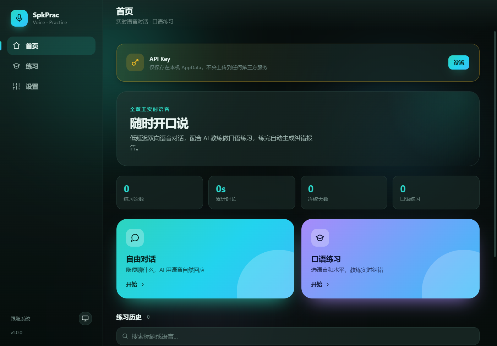

# SpkPrac for Windows

Android 版 [SpkPrac](../README.md) 的 Windows 桌面移植版：全双工实时语音对话 + AI 口语练习。
原生窗口、单文件 exe、**约 3.9 MB**，无安装程序、无运行库依赖（使用系统自带的 WebView2）。



---

## 技术栈与选型理由

| 层 | 选择 | 理由 |
|---|---|---|
| 外壳 | **Tauri v2** | 复用系统 WebView2，单 exe ~4 MB；Electron 同等功能要 100 MB+，.NET 自包含要 40 MB+ |
| 后端 | **Rust** | WebSocket 需要在握手时带 `Authorization` 头，浏览器 `WebSocket` API 做不到，必须落到原生层 |
| 前端 | **原生 HTML/CSS/JS** | 无框架、无打包器、无 node_modules；直接由 Tauri 内嵌进二进制 |
| 音频 | **Web Audio API** | Chromium 自带回声消除/降噪，实测 `echoCancellation:true` 生效 —— 这是全双工语音能不能用的关键 |
| 动效 | **Canvas + CSS** | 语音球等全部手写，不引入动画/图表库 |

**关键设计**：音频走 WebView2（拿到系统级 AEC），网络走 Rust（拿到可控的 WS 握手），两边用 IPC 连起来。
这是唯一能同时满足「包体小」「全双工可回声消除」「鉴权头可设置」的组合。

---

## 功能（与 Android 版对齐）

### 对话
- 实时语音对话，服务端 VAD 自动断句；也支持**按住说话（PTT）**
- **允许打断**：你一开口，AI 立刻停（本地播放缓冲同步清空）
- 断线自动重连（最多 3 次，指数退避），重连后**重放最近 40 条上下文**
- 文字输入框可随时补一句（未连接时自动回滚气泡并提示）
- 实时字幕：你的 / AI 的可分别开关
- **实时翻译**：每条发言下方附目标语言译文（走文本模型）
- 会话计时、轮数统计、麦克风电平波形

### 口语练习
- 15 种语言 × 4 档 CEFR 水平
- 话题输入 + 8 个快捷话题
- 纠错策略三档（不纠错 / 偶尔 / 经常）
- 结束后用文本模型生成 Markdown **练习报告**（总体表现 / 语法与用词 / 更地道表达 / 下次建议）
- 报告可复制、可重新生成

### 历史与数据
- 会话自动落盘（JSON），首页展示**次数 / 累计时长 / 连续天数 / 练习数**
- 标题与语言搜索、二次确认删除
- 详情页：报告卡片 + 完整对话 + 导出 Markdown + 复制全文
- 设置页可导出全部会话到 `文档\SpkPrac`，或清空全部

### 外观
- 深色 / 浅色 / 跟随系统，原生标题栏同步跟随
- 中英双语界面（可切换，立即生效）
- 字幕字号三档、**动效总开关**、波形开关
- Aurora 流光背景、Canvas 语音球（聆听随电平脉动 / 思考虚线旋转 / 说话环形波纹 / 失败静止）
- 气泡进场动画、思考三点、渐变压感卡片、页面转场

### 音频设备（桌面版增强）
- **麦克风与扬声器都能单独选**（`getUserMedia` deviceId + `AudioContext.setSinkId`）
- 设备列表异步枚举，插拔后可在会话中切换
- 麦克风增益 0.5–3×

### 版本与更新
- 设置页显示版本、手动检查更新
- 自动检查：启动时一次，**每 24 小时最多一次**
- GitHub API 直连失败自动回退 **gh-proxy 镜像**，另有镜像开关
- 只认 `pc-v*` 标签的 Release，不会把 Android 的 APK 当成 Windows 更新
- 发现新版本可下载 exe 并自动定位到资源管理器

---

## 构建

前置：Rust 1.77+、Node 不需要、WebView2 运行时（Win10/11 已内置）。

```bash
cd PC
cargo build --release
# 产物：target/release/SpkPrac.exe
```

不需要 `npm install`、不需要 `tauri-cli`、不需要前端构建步骤。

图标由 `make_icon.py` 生成（Pillow）。

### 体积构成

| 项 | 大小 |
|---|---|
| 最终 exe | **3.97 MB** |
| 其中 Tauri + wry + WebView2 绑定 | 约 2.6 MB |
| 网络栈（tokio + tungstenite + native-tls/Schannel） | 约 0.7 MB |
| 应用逻辑 + 内嵌前端 | 约 0.6 MB |

优化手段：`opt-level="z"` + fat LTO + `codegen-units=1` + `panic=abort` + `strip`；
TLS 用 Windows 自带 Schannel 而非 rustls（省掉整套根证书）；前端零依赖、零打包器。

---

## 项目结构

```
PC/
├── Cargo.toml
├── build.rs
├── tauri.conf.json          # 窗口、资源目录、打包配置
├── capabilities/            # Tauri v2 权限（事件/窗口 API 白名单）
├── make_icon.py             # 图标生成
├── preview/session.html     # 会话界面离线预览（假数据驱动，不打包）
├── src/
│   ├── main.rs              # 命令注册、文件导出、外链
│   ├── settings.rs          # 设置结构与原子写入
│   ├── sessions.rs          # 会话 JSON 存储、统计、导出
│   ├── realtime.rs          # WebSocket 传输（带鉴权头）+ 事件回传
│   └── net.rs              # 文本模型调用 + 更新检查/下载
└── ui/                      # 前端（原样内嵌进 exe）
    ├── index.html
    ├── css/{base,components,screens}.css
    └── js/
        ├── i18n.js          # 中英双语
        ├── ui.js            # DOM/图标/弹窗/Toast
        ├── api.js           # IPC 封装（浏览器下自动降级为 mock）
        ├── store.js         # 设置状态 + 主题应用
        ├── audio.js         # 采集/播放/设备
        ├── pcm-worklet.js   # 音频线程
        ├── rt.js            # 实时协议
        ├── session.js       # 会话状态机（对应 Android SessionViewModel）
        ├── orb.js           # Canvas 语音球
        ├── markdown.js      # 轻量 Markdown
        └── screens/         # home / practice / session / detail / settings
```

架构刻意与 Android 版一一对应：`session.js` 就是 `SessionViewModel` 的逐行移植
（同样的状态枚举、重连策略、PTT 提交阈值、报告持久化顺序、跨会话竞态保护）。

---

## 发布

PC 版 Release 用独立标签，避免与 Android 混淆：

```bash
git tag pc-v1.0.0
git push origin pc-v1.0.0
```

把 `SpkPrac.exe` 作为资产上传到该 Release，应用即可自动检测到。

---

## 已知限制

- **未做代码签名**：首次运行时 Windows SmartScreen 可能提示「未知发布者」，需点「更多信息 → 仍要运行」
- 需要在系统设置中允许桌面应用访问麦克风（设置 → 隐私 → 麦克风）
- 单 exe 无安装程序；如需开机自启/开始菜单项，可自行创建快捷方式
- 实时语音依赖服务端 `wss://` 接口与有效 API Key，离线时不可用
- 音量增益过高会削波，建议 1.0–1.8×
- 报告与翻译走文本模型，会产生少量 token 费用

## 与 Android 版的差异

| 项 | Android | Windows |
|---|---|---|
| 音频路由 | 通讯设备枚举（外放/听筒/耳机/蓝牙/USB） | 系统音频设备枚举（麦克风 + 扬声器） |
| 更新包 | APK | exe（`pc-v*` 标签） |
| 触感反馈 | 有 | 无（桌面无马达） |
| 后台常驻 | 无前台服务 | 窗口关闭即退出 |
| 界面布局 | 单列手机布局 | 侧边栏 + 双栏会话页 |
